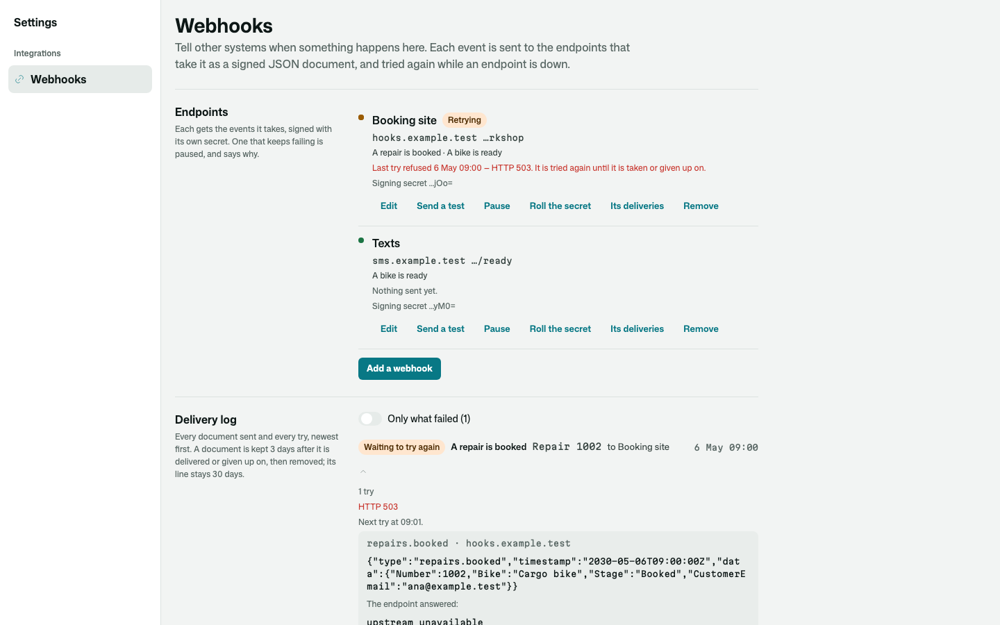
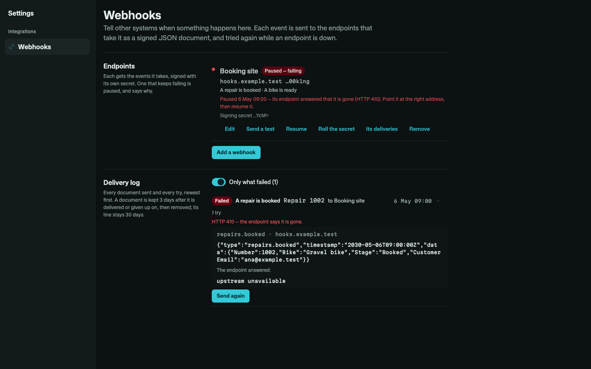
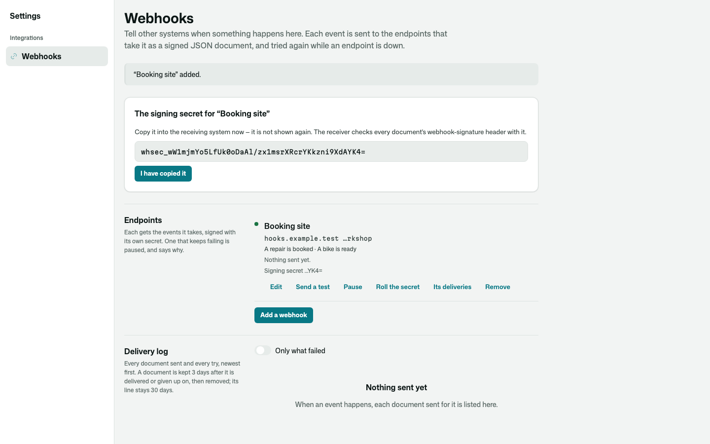

# Osysharp.Webhooks

Tell other systems, over HTTP, when something happens in your app. An administrator subscribes an endpoint to some of
your app's events — "a bike is ready", "an order is paid" — and each time one happens the endpoint is sent a signed JSON
document. Delivery is durable: tried again with doubling waits while the endpoint is down, given up on in the end, and
every try in a delivery log your administrators can read.

The kit never knows what your events are about, and you do not tell it. Every event your app and its kits raise
about a record can be subscribed to, under the name its class gives it. You say only what a document carries, when you
want your own API shape of a record sent rather than its type and id.

```osy
use Osysharp.Webhooks@0 { egress "*"; }      // endpoints are chosen by your administrators — any public host

policy ManagesWebhooks => IsAdmin;           // who adds, tests, pauses and removes them

[Event("A bike is ready")]
public sealed class ReadyForPickup { public Repair Repair; }     // any event about a record — goes out as "ready-for-pickup"

Raise(new ReadyForPickup { Repair = repair });                   // wherever it happens

app.Webhooks = new WebhooksSetup { Documents = [new RepairDocument()] };
public class RepairDocument : WebhookDocument<Repair> {          // optional: what a document about a repair carries
  public override string Data(Entity record, Event e) {
    var r = (Repair)record;
    // Enums by name ("Ready", not 2) — the receiver does not know your numbering.
    return JsonSerializer.Serialize(new RepairData { Number = r.Number, Bike = r.Bike, Stage = r.Stage },
                                    new JsonSerializerOptions { EnumsAsNames = true });
  }
}

[On] void TellTheOwner(WebhookPaused e) { … }                   // an endpoint kept failing and was paused
```

An event goes out under its class's name: your `ReadyForPickup` as `ready-for-pickup`, a kit's `ArticlePublished` as
`knowledge.article-published`. Nobody types an event name.

## What it does

| | |
|---|---|
| **Events** | every event about a record — your app's and every kit's — each by its label. An event no subscription takes costs nothing: the kit hears only the events some active subscription takes, so it is not even written; a subscription made now is sent the very next one, and the subscriptions of the events one commit raised are read once between them |
| **After the commit, off the request** | each document is built once the work that raised the event is saved, so nothing is sent about work that was rolled back, and every retry sends the same bytes; it is posted by a run of its own, so a slow endpoint never holds anybody's click |
| **Signed** | the [Standard Webhooks](https://www.standardwebhooks.com) scheme: `webhook-id` (the same on every retry, so a receiver drops a repeat), `webhook-timestamp`, and `webhook-signature: v1,<base64 HMAC-SHA256 of "id.timestamp.body">` under the subscription's own secret. Every Standard Webhooks library verifies it; an Osy# receiver calls `VerifyWebhook` |
| **The secret, shown once** | minted by the kit, shown to the person who made the subscription in that one moment, and kept sealed. Rolling it keeps the old secret signing beside the new one for a day, so a receiver moves over without missing a delivery. The endpoint's address is sealed too: the page shows its host and last characters |
| **Retries** | refused (any answer but 2xx, or no answer) and it is tried again after 1, 2, 4, 8 minutes… — ten tries over about eight and a half hours by default, then given up on. An endpoint that answers `410 Gone` is given up on at once |
| **Failing endpoints** | a subscription whose deliveries are given up on five times in a row is paused, says why on its row, and `WebhookPaused` is raised, so your app can tell someone (it says itself: "Paused: its endpoint kept failing — HTTP 503"). Resume it once the endpoint is fixed |
| **Send again** | a failed delivery can be sent again by hand while its document is kept |
| **Personal data, kept short** | a document is kept three days after it is delivered or given up on, then removed — with whatever the endpoint answered — and the log keeps only the line (what, where, when, how it went) for thirty days |
| **Where it may send** | `egress "*"` lets the kit reach any public host, and your organization can still narrow that. When its egress policy is a list of allowed hosts, an endpoint outside it is refused as it is added, with a sentence naming the host: *"Add `hooks.example.com` to your organization's allowed hosts…"*. Every delivery asks again before it is sent, so if a host is later taken off the list its next delivery is not sent and its subscription is paused at once, saying why. A deny set by your app or your organization works the same way, and internal addresses are never reachable |
| **Only what its maker may read** | a subscription is sent a document about a record only when the person who made it may read that record, under their own rules |
| **The page** | `/settings/webhooks` in your app's settings area: each endpoint with how it is doing, adding and editing, a test send, pause and resume, rolling the secret, removing; and the delivery log, newest first, narrowed to what failed or to one endpoint, each line opened to show what was sent and what the endpoint answered |

| An endpoint that is down — retrying, and what it answered | Paused after it kept failing — send a delivery again |
|---|---|
|  |  |

| The signing secret, shown once |
|---|
|  |

## Checking a signature on the receiving end

```osy
var ok = VerifyWebhook(Secret.RepairsHook,
  Request.Header("webhook-id") ?? "", Request.Header("webhook-timestamp") ?? "",
  Request.Header("webhook-signature") ?? "", Request.RawBody ?? "");
```

It is true only for the exact bytes that were signed, under that secret, for that id, within five minutes of now — one
character changed, another secret, another id or an old request replayed all answer false.

## Its tests

The kit's test app is a bicycle repair workshop — repairs booked, made ready and collected — so the kit is shown
working outside any one kind of app: documents signed and checked (and refused when tampered with), sent only for the
events an endpoint takes, retried with doubling waits and given up on, a failing endpoint paused and the app told, a
delivery sent again, documents removed after three days and lines after thirty, nothing sent about a record its
subscription's maker may not read, and the page — wide and on a phone, light and dark — run with `osy test`, and
photographed in a real browser with `osy test --pixels`.
